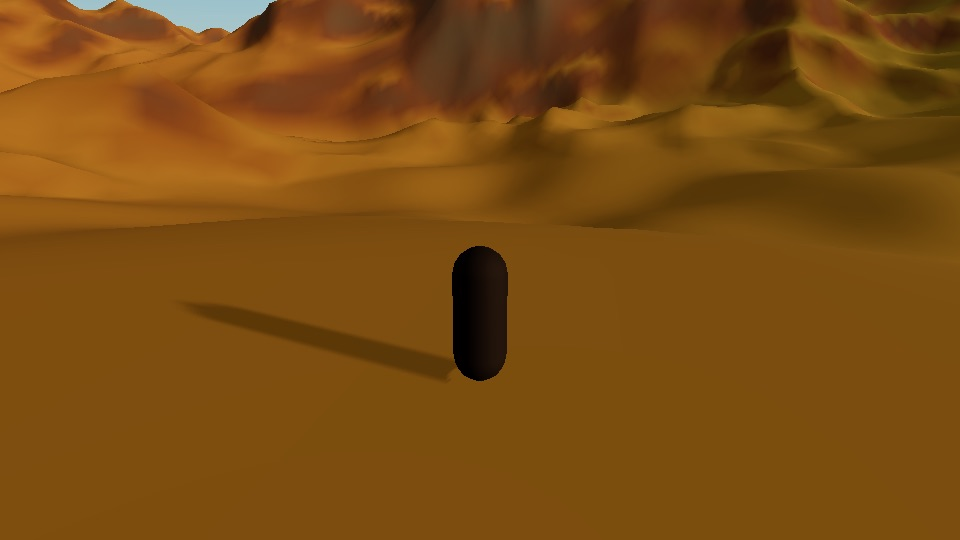
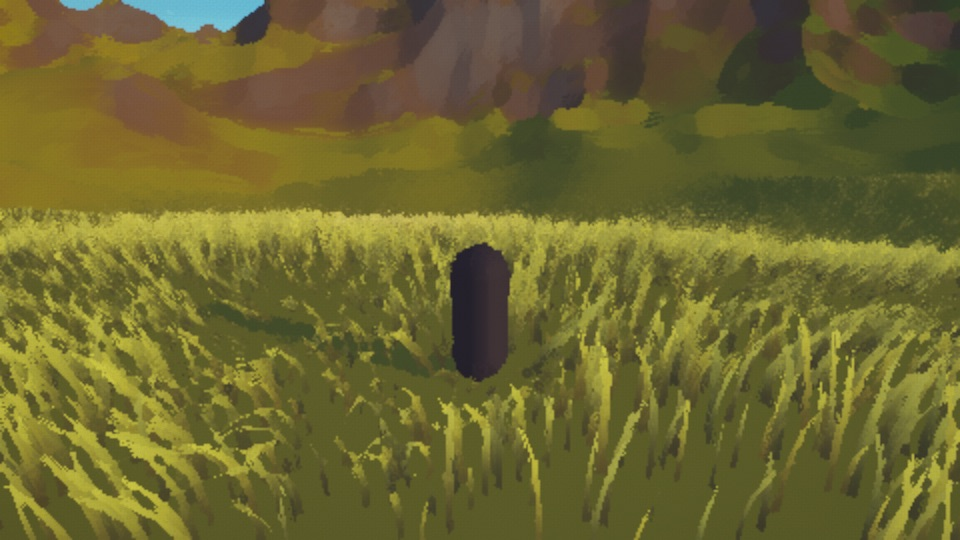
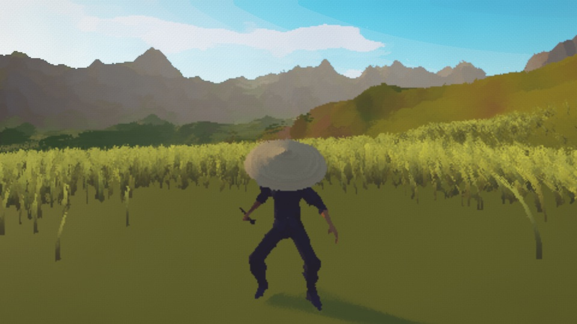
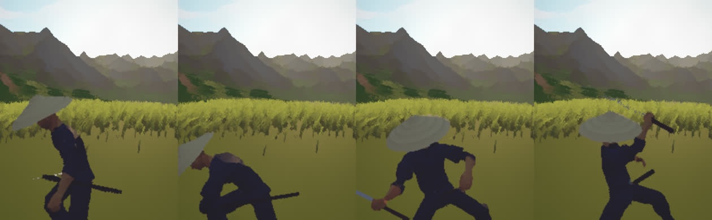
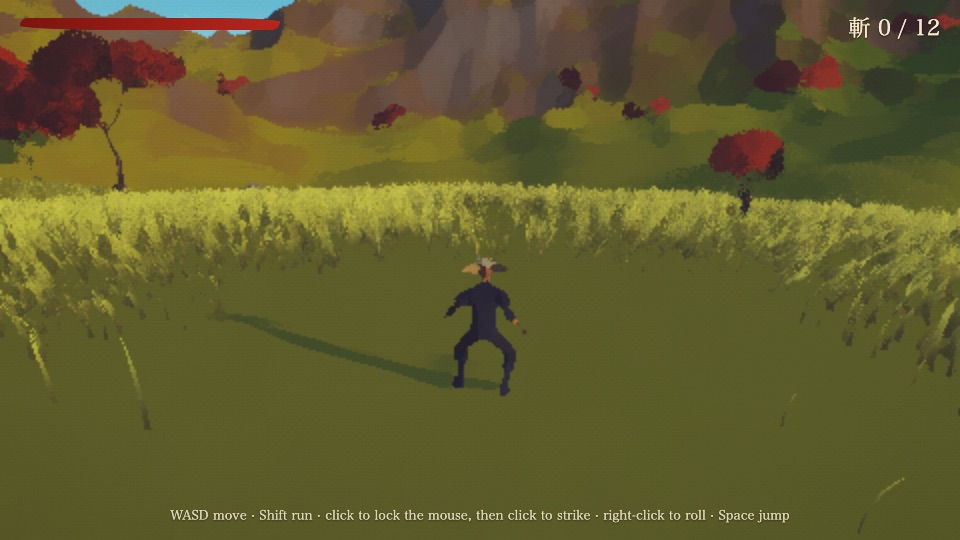
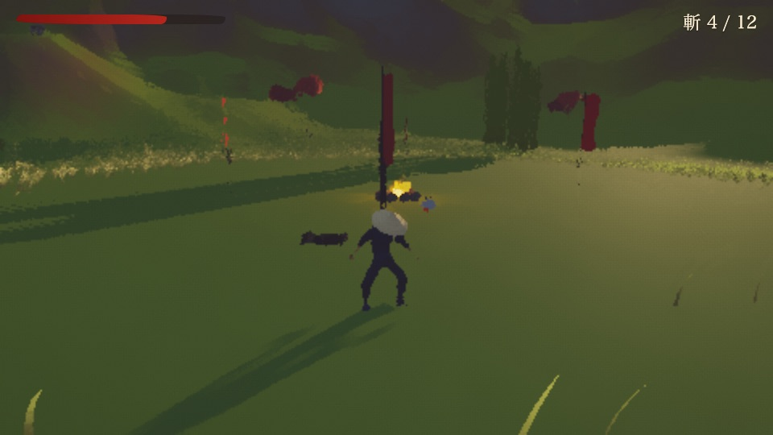
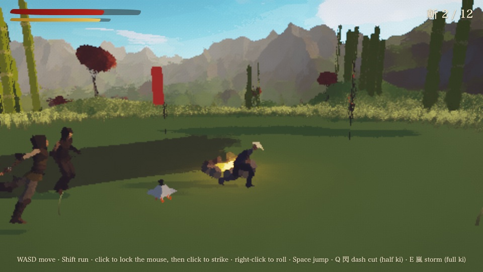
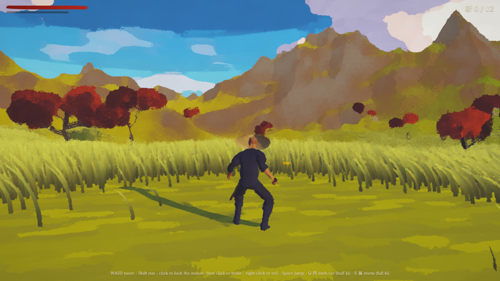
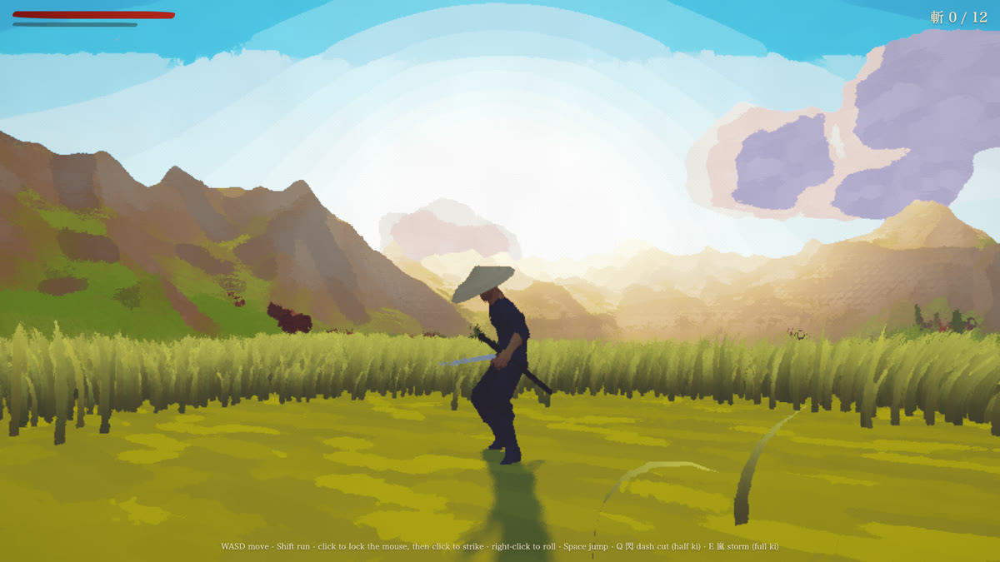

# How Painted Ronin was made, and how to make yours

*Painted Ronin* is an original samurai open world in oil paint: a ronin, a valley of golden grass in the wind, red maples, a shrine on a
hill, three bandit camps. It was built by Claude Code from this repo in one evening. Every system in it comes from a library or a
method that shipped before; the game's own code is the glue, the rules and the look. Here is the order it was built in. Each step is
small enough to see working before the next one starts. The painted look of everything (step 6) was added later the same night.
**Play it:** https://notesmosaic.com/sim/9MV2-XeIEoAASJo2

## 1. The land you can stand on (Jolt + FastNoiseLite)
One height function (`world.js`) feeds three things: the terrain mesh, Jolt's `HeightFieldShape` and everything placed on the ground.
What you see is what you stand on. The player is Jolt's `CharacterVirtual`, ported from `character_virtual.html`: it climbs slopes
up to 50°, steps up 45 cm, sticks to the floor and doesn't slide when standing still.

*Checked:* `tools/check.mjs` boots it in Chromium and WebKit with no errors.

## 2. The painting (grass + the Kuwahara filter)
The grass is SimonDev's Quick_Grass (MIT), the method of Ghost of Tsushima's GDC 2021 talk: instanced patches around the camera, a
6-segment blade near you and a 1-segment one far away, wind from two noise fields, blades leaning away from the player. About 59,000
blades are on screen at once.
The oil paint is Maxime Heckel's anisotropic Kuwahara (MIT code; the method is Kyprianidis et al., 2009):
- a Sobel structure tensor, blurred;
- 8 sectors weighted by a polynomial;
- a grade.

It runs at 0.5-0.7 of the screen's resolution, with the brush small near the camera and wide in the distance, so the hero stays
readable while the land turns to paint.

*Found on the way:* `THREE.MathUtils.smoothstep(h, 70, 40)` with its bounds reversed returns 0 everywhere, and there was no grass at all.

## 3. The ronin (Quaternius CC0 + glTF-Transform)
No free samurai model exists under a licence a game may ship (searched: Quaternius, KayKit, Kenney, Poly Pizza, Sketchfab). So the
ronin is built from Quaternius's CC0 pieces, which all share one 65-bone rig:
- **Body:** the Modular Character Outfits peasant, dyed indigo by a gradient map.
- **Head:** cut from the Universal Base Character by its bone weights (the triangles whose corners follow `Head` or `neck_01`).
- **Clips:** 21 from the Universal Animation Libraries.
- **Made here from simple shapes:** the kasa hat (a lathe profile), the katana (gripped where a fist holds a blade: on the thumb's
  side, square to the fingers) and the scabbard.

`tools/build_assets.mjs` does all of it and shrinks the result for a phone. 10 MB of clips became 740 KB once the removed clips' samplers
were disposed too.

 

## 4. The world and its people (Recast & Detour + Jolt ragdolls)
- **The world:** Quaternius's CC0 torii, temple, maples and bamboo, and Matt Newell's CC-BY stone lantern, each with a Jolt collider.
- **The bandits:** Detour crowd agents on a navmesh baked from the terrain around each camp (53-75 ms per camp). They idle at camp,
  chase, wind up a blow you can read, then recover.
- **When they fall:** they become Jolt ragdolls, built on the same rig, with one-way knees and elbows and limits counted from the
  REST pose.

 

*Found on the way:* JoltJS returns `Ragdoll.GetBodyID(i)` in one shared temporary. Storing the returned objects made every bone
follow one shin, and every corpse lay straight. The first ragdoll test passed on that (every knee at exactly 0°): a perfect reading
was the clue.

## 5. The fight and the specials
- **Combat:** a three-strike combo (the third is heavy), hit-stop of 0.07-0.11 s, trauma² screen shake, a roll with invulnerability
  frames, and a parry when blades meet.
- **The lock:** every strike goes to one locked bandit (an ensō under him), up to 12 m away; past reach the ronin closes with an
  authored dash attack, carried by its own feet (§7).
- **Ki:** fills from hits, kills and parries.
  - 閃: a leaping dash that cuts a line. The bandits fall a beat after the blade passes, and a thin ink stroke hangs in the air.
  - 嵐: three beats of cuts all around.
- **The air:** three.quarks carries the falling leaves, sparks, red ink and fires.
- **Sound:** ZzFX, plus a Karplus-Strong koto.

## 6. One painted language (MyPaint's brushes, Sea of Thieves' clouds, a printed sky)
Looking at it, the owner said the clouds "must look painted well instead of just meshes too". A post filter alone does not make a
painting: over a smooth gradient the Kuwahara filter returns what it was given, and Alex Evans (Dreams) said it plainly — *"I have a
strong dislike of 'painterly post fx'"*. So everything painted now speaks one language, the one shipped painterly work shares (Meier's
"Painterly Rendering for Animation", SIGGRAPH 96; Disney's Deep Canvas; Dreams' splats):
- **One brush.** `tools/bake_brushes.mjs` paints `assets/paint/atlas.png` with MyPaint's own brush engine (libmypaint 1.1, ISC, ported
  from its C source in `tools/mypaint_port.mjs`) from MyPaint's CC0 presets: Tanda's oil brushes, the dry brush, kabura's sumi stroke,
  pointy ink. The atlas holds value and coverage, never colour (Meier: *"the brush itself does not impart color, just texture"*).
- **Strokes belong to the object, never the screen.** On the ground, the rocks and the banners they are laid in the world (triplanar);
  on a leaf, a puff of smoke or a spark, in the particle's own quad; on a cloud, on its own body. A bird is three brush strokes.
- **Three bands of light, sixteen colours, one wind.** A 3-texel ramp (Valve's TF2 "warp"; `MeshToonMaterial`) whose band edge is moved
  by the bristles, so a shadow's edge is a brush edge; every authored colour a swatch; and the wind that drifts the clouds also leans the
  grass, carries the leaves and the smoke and flies the banners (Ghost of Tsushima: one wind in "nearly every single effect").
- **Clouds the way Sea of Thieves made them** (SIGGRAPH 2018): opaque puffs, boiled by noise, drawn into a small buffer, blurred into
  one mass, then given a painted edge, three tones (warm cream, rose, violet-grey) and a silver lining when the sun is behind them.
- **A painted sky.** three.js's own `Sky.js`, patched: four soft tones (Gurney's sky mixes), oil strokes anchored to the sky's own
  directions, and the ukiyo-e bokashi, a Prussian-blue band printed across the top with an uneven edge. The fog walks to the sky's own
  horizon colour, measured off the sky (Firewatch).

 

*Found on the way:*
- Running the downloaded libmypaint.js was refused by the session's safety check, so its engine was ported from the C source, read at
  source.
- A MyPaint preset's size is a scale of its own base. Forcing pointy_ink's base to 22 px under its +3.36 pressure curve painted a 630 px
  disc.
- The grass leaned along −z while the clouds drifted along +x: two winds.
- Three of the new walls lied on their first try, and their plants proved it:
  - the sky's strokes were measured through a tensor that the sky's own smooth gradient filled;
  - the "silver lining" was the sky bleeding into the cloud's anti-aliased edge;
  - two walls read whichever random cloud was in view.
  They now measure fine detail, the cloud's own colour, and two clouds placed for the test.

## 7. His notes on the film (8 Nov), and what each became
He watched the reveal and wrote four notes. Each became a measured rule with its plant:
- **"The clouds are moving way! Too fast! It's supposed to be going slow like a normal day!"** Two causes, both measured:
  - `skyPaint.update(time * 1000)` fed Sky.js milliseconds. Its clock counts **seconds**: three.js's own example feeds it
    `performance.now() * 0.001`. Its cloud sheet drifted and churned 1,000× too fast.
  - On seconds, three.js's default sheet speed still read 2.4°/s across a view 40° up. Cirrus crosses about 0.2°/s, so the sheet is
    slowed to 0.14°/s.
  - The rule is the pace the eye reads, in degrees a second: overhead fair-weather cumulus, 1-1.5 km up in a 5-10 m/s wind, cross
    0.2-0.6°/s.
- **"We have one big patch of clouds too that don't make sense."** The painted clouds sat 70-150 m up, on a ring that ran through the
  mountains (peaks ~72 m), so a cloud could hang in the hills.
  - They are now one deck: fair-weather cumulus have "uniform flat bases" (the AMS glossary, cumulus humilis), every base 320 m up,
    248 m over the highest peak.
  - They are spread over 2 km, and no two sit closer than their breadths, so they recede in perspective instead of merging.
- **"hitting mostly nothing and not locking on to my enemy"**: strikes looked for a bandit in a 70° cone within 6 m. Now there is **one
  lock**, as in Arkham's Freeflow (a strike "will leap across the screen and find the nearest enemy that he is facing"; the next foe
  when one falls) and God of War 2018 (target from stick and view; the attacks face it). An ensō is brushed under the locked bandit.
- **"sloppily sliding to them instead of jumping and attacking"**: the warp slid the body along the ground at up to 12 m/s. Every
  approach is now in the air:
  - **fumikomi**: kendo's lunging step, the cut's own clip carried in a low arc.
  - **the approach, three tries and his verdicts:** a composed jump with tucked legs ("It looks like a frog rather than a leap to the
    enemy!"); a low lunge-stride leap with the front leg locked straight ("The front leg knee needs to bend … Did you use any reference
    clips at all"); then his word: "No front flip!" · "Just dash attack" · "We don't want the guy to roll, just dash to the opponent
    with the leg bend". The lesson: start from shipped moves and authored clips, never compose a move from guesses.
  - **what it became, from references read first** (research J): **the dash attack** is Quaternius's authored CC0 `Sword_Dash`, the
    whole body as he made it (Sekiro's Shadowrush, "a long range, powerful thrust"; Ninja Gaiden 4's Flying Swallow closes on a locked
    enemy ~2.3× faster than running). Measured on our rig, the clip is authored in place and always has one foot down, so the body
    is carried by its own feet (Daniel Holden's foot locking): over its planted left foot through the step (0.75 m), then on its planted
    front foot; only the rest of the gap is flown, low (≤ 0.13 m: kendo's "forward instead of upward"), and only during the step, the
    front foot landing with the cut (ki-ken-tai-icchi). From 7 m: 6.07 m in 0.53 s, 0.12 m up, the front knee 66° at mid-dash, a
    planted foot slid 0.18-0.20 m. The near lunge was measured the same way and slid its planted feet 0.41 m; it now moves while its feet
    are up (0.15 m).
  - 閃 jumps through its line.
- **"The sky transition horizon needs to be better because it's just light blue band to dark blue bands."** The sky's four tones were
  cut with a blend over 24 % of each step: flat bands with a line between. Painters grade it wet (Gurney: "gradate from a more saturated
  blue at the top to a paler and warmer blue at the horizon"; Masuyama pre-wets the paper for "soft edges"), so each step now blends over
  70 % of its span and its edge wanders with the strokes. A dither by the brush was tried first and read as blotches. Measured against
  the smooth sky under it, the sky is flat over 20 % of where it should still change (the old bands: 53 %).
- **"many slashes on one enemy to show the various types of damage … then when we kill him, leap to the next guy and free flow"**: the
  fight film (`film/fight2.js`) waits on the game's own states, beat by beat: the dash in, a cut he blocks, a wound, the heavy that
  breaks his worn guard (Sekiro's posture), quick cuts into the dazed man, the heavy that kills (crimson), the lock passing on by itself
  (Arkham Knight), then a dash to each of the camp's others. Rehearsing it found two defects of the game: a bandit's guard was judged from
  the way a cut pushes, so no sideways cut was ever blocked (now it faces the man who strikes), and a press made after a clash was
  dropped because the cut's clip ended before its window (now it chains). The first bandit's health is raised and his guard made certain
  for the film, said in the script.
- **"The attack slashes are too wide in strokes and must be thinner"**: the crescent ran from near the hilt to past the tip, about a
  metre wide.
  - It is now a band along the tip's path, a fifth of the blade at its widest, drawn to a point at both ends.
  - The sword's ribbon follows the blade's last fifth.
  - The specials' ink is 0.34 m (was 1.3).
- **"We also want the slashes to get thicker as they injure their enemies to make cooler paint stroke effect and show death."** A
  calligrapher's stroke widens as the brush is pressed and thins as it lifts ("light pressure for thin lines and heavy pressure for
  bold strokes"). So the crescent carries a pressure:
  - in the air the brush is lifted (0.13 m);
  - where the blade meets a body it presses (×2, 0.26 m);
  - on a death it presses hard (×3.5, 0.46 m), turns to crimson ink and lingers 1.4 s;
  - 閃's and 嵐's ink lines swell the same way over the bodies they cut (×1.5 a wound, ×2.2 a death).
- **"The red flags don't look like they've been painted either and look too solid."** Their strokes were laid in the world, so they
  swam over a banner that swings, which broke our own rule that strokes belong to the object. A nobori is a long dyed cloth, painted by
  hand with a crest, and Ghost of Tsushima flies its banners as cloth in the one wind (Rockenbeck, GDC 2021). Now each banner has:
  - the oil field in the cloth's own space, broad enough to outlive the oil pass, darker where the dye pooled;
  - an outline from the sumi stroke, frayed into streaks on the free side and at the foot;
  - an ensō crest brushed with the same stroke;
  - a wave that runs downwind from the pole.

## 8. The ink cut's beats, painted (8 Nov, evening)
The pixelfx skill turned this game's slash into a pixel "ink cut" that added three beats: an ink blot at contact with the stroke bare
paper, flecks that land as stains, and the blade flicked clean. On the owner's word they came back into the game, painted in its own
language. The references were read before any code (the receipts' `2026-11-09_pixelfx/painted_ronin/RESEARCH.md`):
- **The blot** is a shock frame. Sakuga Booru: "Special frames drawn by animators that appear for a split second, often added to make an
  impact more pronounced". It is splashed ink (Sesshū's hatsuboku) from the one atlas: MyPaint's ragged mass and 12 small dabs off its rim
  (Worthington: a splash's rim splits into drops). It is drawn over the world and behind the fighters by render order, and held through
  the hit-stop on the game's clock (Sakurai: "both parties momentarily freeze").
- **The flecks** fly under gravity and air drag (the NIJ report on bloodstains: C_D = 0.28 + 6/√Re + 21/Re). Ghost of Tsushima's
  droplets "land on nearby geometry", and here each lands as three.js's `DecalGeometry` on only the terrain cells under it (the whole
  terrain would stall a phone). It is stretched by 1/sin α and dries away by erosion.
- **The chiburi**: no CC0 library has one, so it is Quaternius's authored `Sword_Regular_A_Rec`, whose arc is o-chiburi's. It plays when he
  stands after a cut that drew blood ("an automatic one if you're standing around": Ghost of Tsushima's art director), and 4 crimson
  drops leave the real blade tip (cast-off and cessation, in ASB TR 033's terms).
- **The pressure, checked:** a cut in the air now shows no crimson. A kill's "flood" was a 75 % mix that read pink, so it is now a true
  crimson flood (W19).

*Found on the way:* `vfx.js` already had a local `N` (the trail's 14), which shadowed the terrain's `N`, so every stain projected onto the
grid's corner and came out empty. The blot first counted the contact frame's own time slice, so WebKit showed a kill's blot for 0.056 s.

## 9. The walls (`examples/painted-ronin/tests/walls.mjs`, `tests/paint.mjs`)
Each wall is a measurement of the running game, in Chromium and in WebKit, proven red by a planted defect:

| Wall | Holds | Planted defect → red |
|---|---|---|
| W2 ragdolls | every knee and elbow in −15°..155° (measured from the bones), bodies at rest on the ground | `knee`: a flipped hinge → knees fold to −136° |
| W3 pursuit | a bandit reaches the ronin through the navmesh within 6 s | `nav`: agents can't move |
| W4 combat | strikes take a bandit down within six blows | `blade`: the blow never lands |
| W5 phone | the page's own memory count < 192 MB | — |
| W6 / W7 specials | the dash fells both bandits in its line; the storm fells both around him | `specials`: no damage |
| W8 turns | four bandits never overspend the attack budget (≤ 10), never more than two strike at once, impacts ≥ 0.29 s apart | `budget`: peak 20/10, four at once |
| W9 contact | at each strike's contact the real sword (off the skeleton) passes within 0.6 m of the bandit's axis | `reach`: 0.8-0.9 m off |
| W10 the lock | a bandit 7 m away at 110° from the ronin's facing: one strike goes to him and lands | `nolock`: the old 70° cone, a miss |
| W11 the dash | from 7 m Sword_Dash, ≤ 0.15 m up, the front knee ≤ 120° at mid-dash, no planted foot sliding over 0.35 m, the blow lands; from 3.5 m the cut's own lunge, its feet ≤ 0.35 m | `frog`: 0.89 m up · `strideleap`: 0.34 m up, knee 141° · `slide`: 2.13 m slid · `flatdash`: 5.45 m slid |
| W14 the guard | a bandit facing the ronin with his guard up blocks a sideways cut | `guardpush`: judged from the push, never blocked |
| W15 the chain | a press made after a clash chains into the next cut | `dropchain`: the press dropped |
| W12 the press | a cut that wounds ≥ 1.6× a cut in the air, one that kills ≥ 2.6× and lingers ≥ 1.2 s; 閃's ink ≥ 1.8× over a death | `nopress`: all 0.133 m |
| W16 the blot | a cut that wounds or kills shows an ink blot behind the fighters for 0.07 s of game time (held through the hit-stop), reaching about his height, the stroke bare paper meanwhile; none on a miss or a block | `noblot` · `blotfront`: his own pixels change · `paperoff`: the stroke 0.35 light |
| W17 the flecks | a wound flings 9 drops along the stroke (4 crimson) and 3 back, a kill 14 (10 crimson); each lands as a stain on the terrain's own triangles and dries away by 2.35 s; none on a miss | `nostains` · `floatstains`: 0.25 m up · `nodry` · `missflecks` |
| W18 the chiburi | standing after a wound, Sword_Regular_A_Rec flicks 4 crimson drops off the real tip ~1.25 s after the cut, landing in a line, each stain stretched by 1/sin α; no flick after a miss | `nochiburi` · `chiburimiss` |
| W19 the crimson | the stroke's own pixels: no crimson in the air, crimson along the inner side of a wound, flooded on a kill | `misscrimson`: 0.45 crimson in the air |

The painted language has its own walls (`tests/paint.mjs`), measured on the materials the game builds and the pixels it draws:

| Wall | Holds | Planted defect → red |
|---|---|---|
| L1 one brush | every painted element samples the one atlas | `leafcanvas`: the leaves' old canvas texture |
| L2 three bands | every lit painted body takes the ramp: 3 texels, Nearest | `ramp256`: a smooth ramp on the rocks |
| L3 one palette | every authored colour of a painted element is a swatch (ΔE OKLab ≤ 0.02) | `crane00ff00` |
| L4 the brush | a crane's outline is cut by the brush (≥ 1.3× its smoothed self) and its body shaded by bristles | `flatbird` |
| L5 one wind | clouds, grass, leaves, smoke and banners all move along the one wind | `wind90`: the smoke turned |
| L6 the budget | atlas ≤ 1024²; the clouds ≤ 4 draws and ≤ 3 MB of targets | `bigclouds`: a full-size buffer |
| S1 bokashi | the top of the picture printed darker (−10 L*) with an uneven edge | `bokashi0` |
| S2 four tones | the sky's light sits on 3-5 tones | `skyramp`: the smooth ramp back |
| S3 strokes | the sky carries strokes (fine detail) laid flat | `strokes0`, `strokes90` |
| S7 graded | where the smooth sky still changes, the painted sky is flat over ≤ 30 % of it | `skybands`: the old 24 % blend, 53 % flat |
| C1-C4 clouds | three tones on the swatches' hues; the shadow cooler than the light; the lit side shows away from the sun; the edge glows toward it | `rampLinear`, `rampGrey`, `sunFlip`, `rim0` |
| C5 the pace | the painted deck ≤ 0.35°/s seen from the valley; Sky.js's sheet ≤ 0.2°/s, on the clock the running game feeds it | `skyms`: 138°/s · `lowclouds`: 0.57°/s |
| C6 the deck | one flat base, ≥ 150 m over the highest peak, no two clouds closer than their breadths | `lowclouds`: −14 m · `cloudclump`: 41 pairs |
| L7 thin | a cut's crescent ≤ 0.22 m, the sword's ribbon ≤ 0.3 m, the specials' ink ≤ 0.36 m | `wideslash`: 0.81 / 0.74 / 1.30 m |
| L9 banners | a banner's free side frayed ≥ 1 % of its width off a smooth curve, ≥ 2 % of it a brushed ink crest, its picture changing as cloth | `solidflags`: 0.0 / 0.0 / 0.0 |

## Make yours
Start from the recipes, not from this game. Tell your agent what you want (a game, its feel, its look) and point it at this repo.
`SKILL.md` tells it the order:
1. Pick from the list.
2. Vendor with `tools/stack.mjs`.
3. Port the recipe.
4. Look at it with `tools/shot.mjs` (and `examples/painted-ronin/tools/looks.mjs` for the painted views: valley, toward the sun, a camp,
   the birds, a phone).
5. Give every surface strokes before the paint pass runs: one brush, one ramp, one palette, one wind (`src/paint.js`).
6. Write the walls and plant them red.
7. `tools/check.mjs`.
8. Publish on NotesMosaic.
